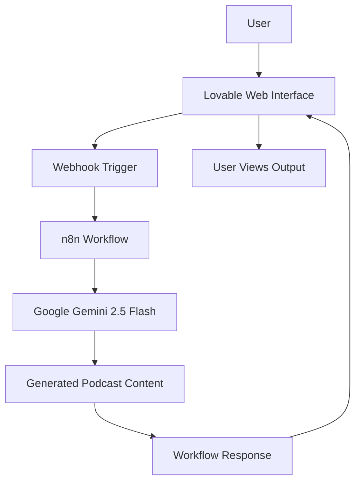

# 🎙️ AI Podcast Generator

Transform ideas into AI-generated podcast content with an automated workflow.

**AI Podcast Generator** is a web-based project designed to simplify podcast content creation using Generative AI and workflow automation. Built with **Lovable, n8n, and Google Gemini 2.5 Flash**, the project connects a user-friendly interface with an automated backend workflow to generate podcast content from user-provided inputs.

## ✨ Features

- **AI-Powered Content Generation:** Uses Google Gemini 2.5 Flash to generate podcast content based on user input.
- **Workflow Automation:** Uses n8n to orchestrate the content-generation process.
- **Web-Based Interface:** Provides a simple interface built with Lovable.
- **Webhook Integration:** Connects the frontend with the automation workflow.
- **Reduced Manual Effort:** Streamlines the podcast content creation process.
- **Modular Architecture:** Separates the user interface, AI processing, and workflow orchestration.

## 🛠️ Tech Stack

| Technology | Purpose |
|---|---|
| Lovable | Web application development |
| n8n | Workflow automation and orchestration |
| Google Gemini 2.5 Flash | AI-powered content generation |
| Webhooks | Communication between the application and workflow |
| Markdown | Project documentation |

## 🏗️ System Architecture



The application follows a workflow-driven architecture:

1. **User Input:** The user provides the topic or other relevant podcast details through the web interface.
2. **Request Handling:** The application sends the input to an n8n workflow through a webhook.
3. **AI Processing:** The workflow passes the relevant information to Google Gemini 2.5 Flash for content generation.
4. **Response Handling:** The generated content is returned through the workflow.
5. **Output Display:** The application presents the generated result to the user.

## 🔄 Workflow

```text
User Input
    ↓
Lovable Web Application
    ↓
Webhook Request
    ↓
n8n Automation Workflow
    ↓
Gemini 2.5 Flash
    ↓
AI-Generated Podcast Content
    ↓
Response to Web Application
```

## 🚀 Live Demo

Explore the project here:

**[AI Podcast Generator — Live Application](https://aipodcastgeneratorshs.lovable.app)**

## 🎯 Project Objectives

- Explore practical applications of Generative AI.
- Automate repetitive content-generation tasks.
- Integrate web applications with AI services through webhooks.
- Understand event-driven workflows and low-code automation.
- Build a modular AI-powered application.

## 🔮 Future Enhancements

- Add text-to-speech integration for audio generation.
- Support multiple voices and podcast narration styles.
- Generate multi-speaker conversations.
- Allow users to customize podcast duration and tone.
- Add downloadable audio files and podcast transcripts.
- Maintain a history of previously generated podcasts.
- Introduce multilingual podcast generation.

## 📚 Key Learnings

- Integrating Generative AI into a web application.
- Building automated workflows using n8n.
- Connecting applications and services through webhooks.
- Designing modular AI-powered application architectures.
